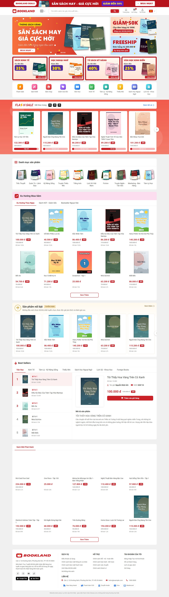
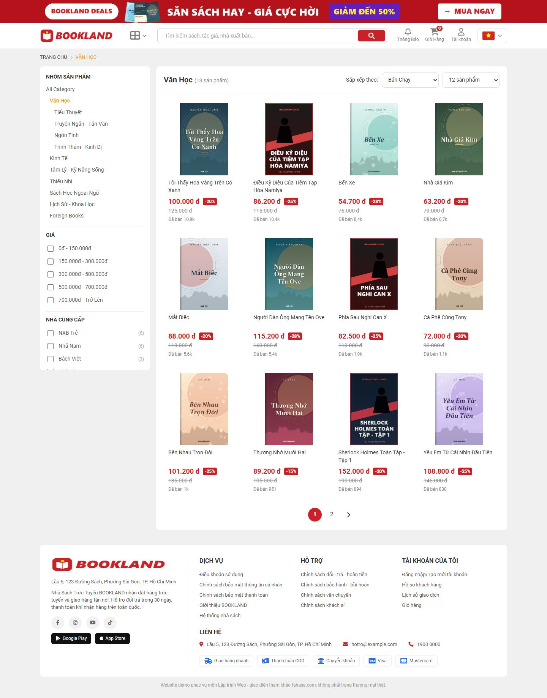
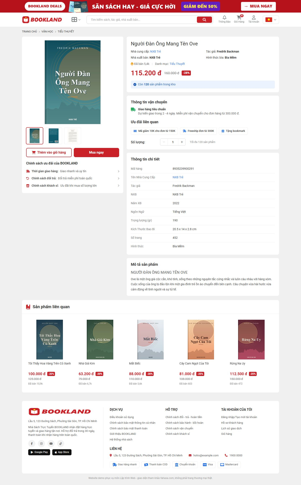
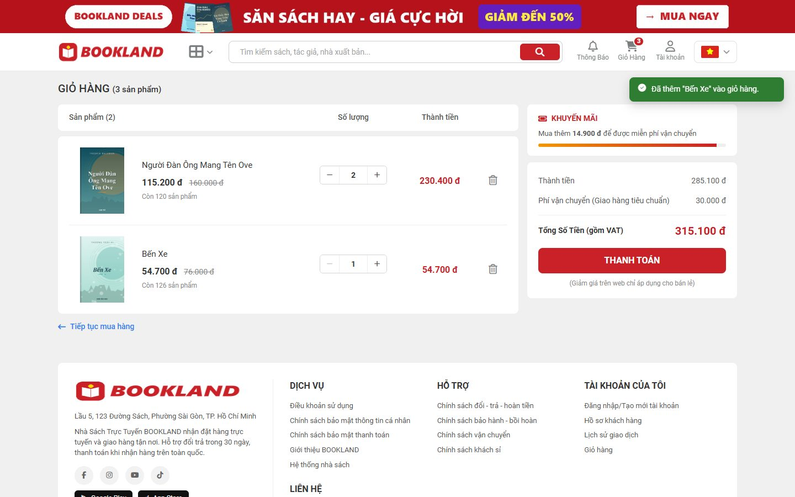
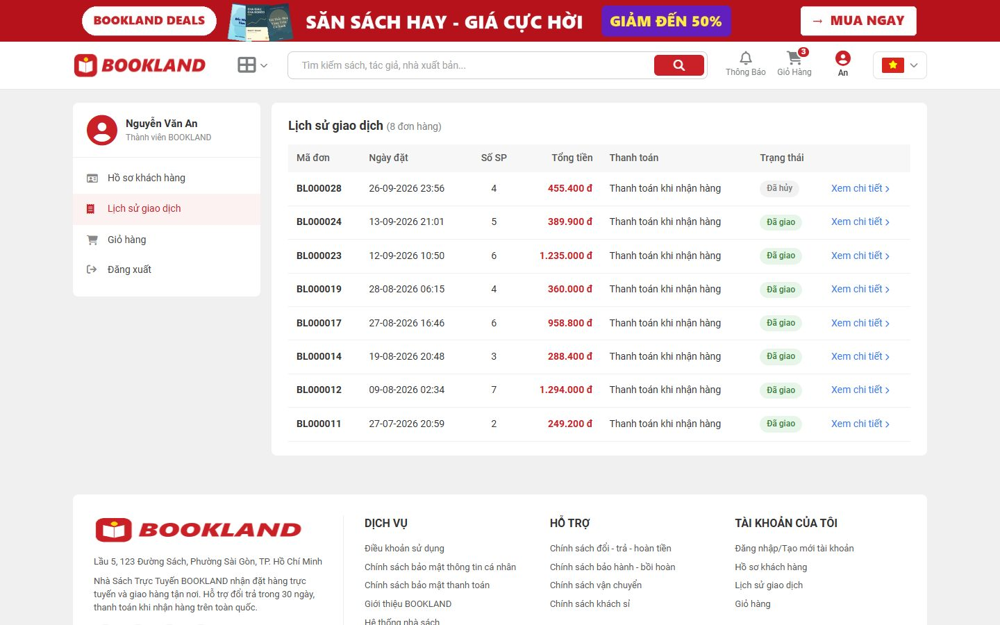
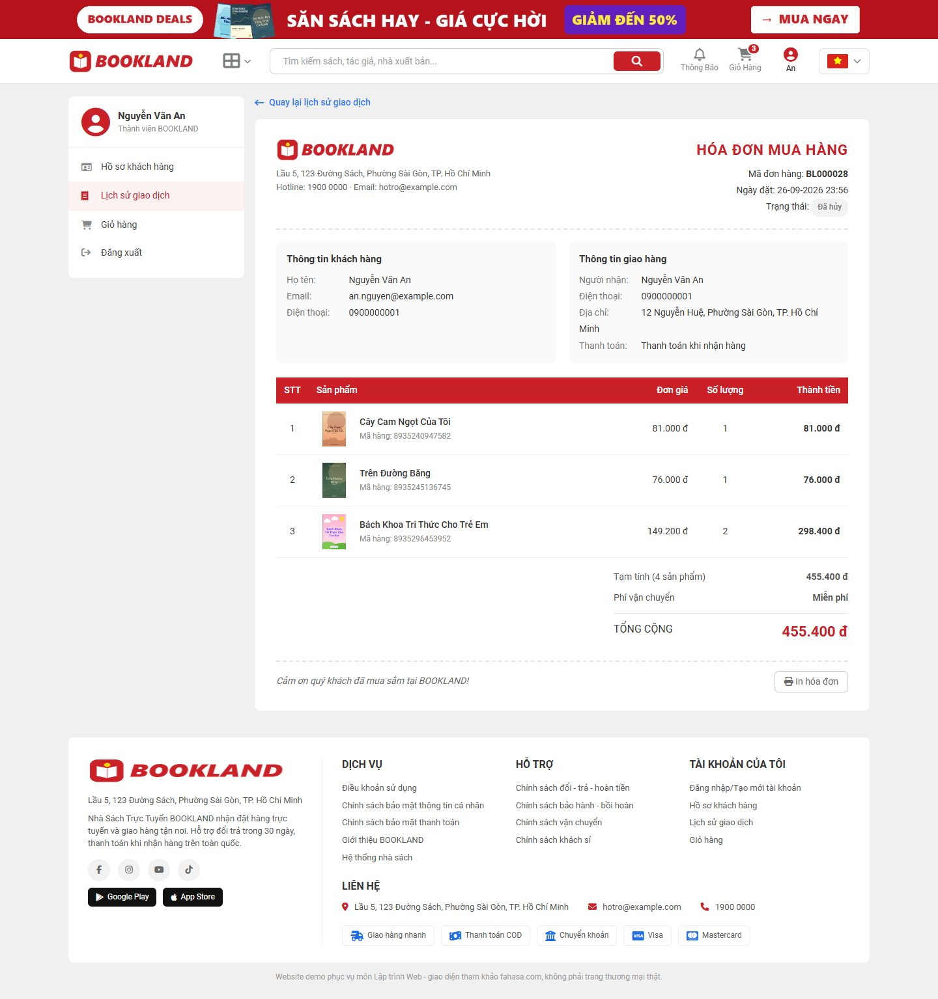
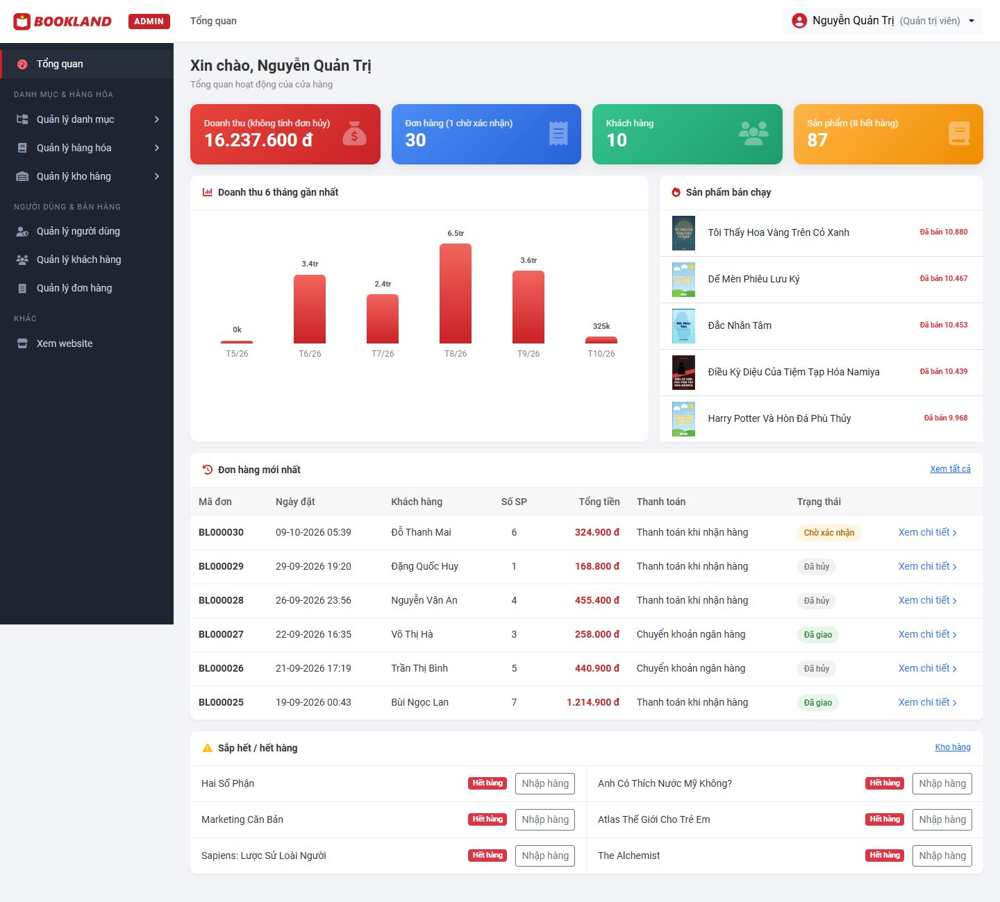
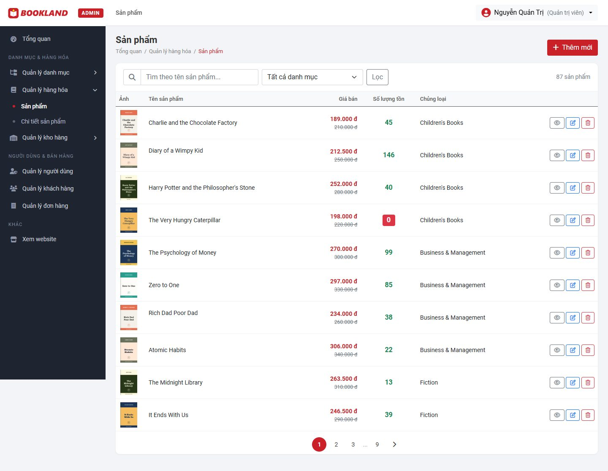
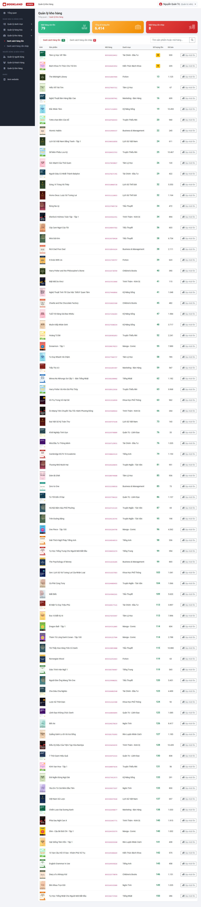

# BOOKLAND – Website nhà sách trực tuyến (ASP.NET Core MVC 8)

Đồ án môn **Lập trình Web**: website bán sách có giao diện phỏng theo [fahasa.com](https://www.fahasa.com/), gồm trang **Khách hàng** (xem, tìm kiếm, lọc, giỏ hàng, đặt hàng, lịch sử giao dịch) và trang **Quản trị** (danh mục, hàng hóa, kho, người dùng, khách hàng, đơn hàng). Mọi chức năng được làm theo file chấm điểm `LTW_Checklist_BE.xlsx`.

> **Lưu ý:** Đây là đồ án học tập. "BOOKLAND" là thương hiệu giả định, không liên quan tới Fahasa. Logo, banner, ảnh bìa sách đều được vẽ bằng code (Pillow), không dùng ảnh có bản quyền của Fahasa. Địa chỉ, hotline, email trong trang đều là dữ liệu giả.



## Công nghệ

| Thành phần | Sử dụng |
|---|---|
| Backend | ASP.NET Core MVC **.NET 8**, Area `Admin`, ViewComponent, Partial View |
| CSDL | SQL Server (LocalDB / Express / Developer), collation `Vietnamese_CI_AI` |
| ORM | Entity Framework Core 8, **Database First** (`dotnet ef dbcontext scaffold`) + lớp Metadata (Data Annotation) |
| Xác thực | Cookie Authentication, 2 scheme riêng cho khách hàng và quản trị, mật khẩu băm PBKDF2-SHA256 |
| Giỏ hàng | Session (JSON), cập nhật bằng AJAX có kiểm tra AntiForgery |
| Giao diện | CSS tự viết theo Fahasa cho trang khách, Bootstrap 5 cho trang Admin, Font Awesome 6, font Roboto (đã tải về `wwwroot/lib`, chạy offline được) |

## Cài đặt và chạy

### 1. Yêu cầu

- [.NET 8 SDK](https://dotnet.microsoft.com/download/dotnet/8.0)
- SQL Server 2016 trở lên: SQL Server Express/Developer hoặc LocalDB (có sẵn khi cài Visual Studio 2022)
- SQL Server Management Studio (SSMS) hoặc Azure Data Studio để chạy script
- Visual Studio 2022 (tùy chọn)

### 2. Tạo cơ sở dữ liệu

Mở SSMS, kết nối tới SQL Server, rồi **chạy lần lượt** 2 file:

1. `Database/01_CreateDatabase.sql`: tạo database `BookLandDB` và 12 bảng (có PK, FK, UNIQUE, CHECK, DEFAULT, INDEX)
2. `Database/02_SeedData.sql`: dữ liệu mẫu gồm 29 danh mục, 87 sách, 10 khách hàng, 30 đơn hàng, 2 quản trị viên

> Script 01 sẽ **xóa database `BookLandDB` cũ** (nếu có) rồi tạo lại, nên có thể chạy lại 2 file bất cứ lúc nào để đưa dữ liệu về trạng thái ban đầu.

Dùng dòng lệnh `sqlcmd` (thay `<server>` bằng tên server của bạn):

```bash
sqlcmd -S <server> -E -i Database/01_CreateDatabase.sql
```

```bash
sqlcmd -S <server> -E -i Database/02_SeedData.sql
```

### 3. Sửa chuỗi kết nối

Trong `BookLand/appsettings.json`, chuỗi mặc định dùng LocalDB:

```json
"ConnectionStrings": {
  "BookLandDB": "Server=(localdb)\\MSSQLLocalDB;Database=BookLandDB;Trusted_Connection=True;TrustServerCertificate=True;MultipleActiveResultSets=true"
}
```

Nếu dùng SQL Server Express, đổi `Server=(localdb)\\MSSQLLocalDB` thành `Server=.\\SQLEXPRESS`. Nếu dùng bản Developer hoặc bản mặc định, đổi thành `Server=localhost`.

### 4. Chạy website

**Visual Studio 2022:** mở `BookLand.sln`, chọn profile `http`, rồi nhấn **F5**.

**Dòng lệnh:**

```bash
dotnet run --project BookLand --launch-profile http
```

- Trang khách hàng: http://localhost:5026
- Trang quản trị: http://localhost:5026/Admin

### Tài khoản demo

| Vai trò | Tên đăng nhập | Mật khẩu |
|---|---|---|
| Khách hàng | `an.nguyen@example.com` hoặc `0900000001` | `123456` |
| Quản trị viên | `admin` | `Admin@123` |
| Nhân viên | `nhanvien01` | `Nhanvien@123` |

Mọi khách hàng mẫu (`0900000001` → `0900000010`) đều dùng mật khẩu `123456`.

## Cơ sở dữ liệu

Database được phân tích từ thông tin trên trang sản phẩm của Fahasa: tác giả, người dịch, NXB, nhà cung cấp, năm XB, ngôn ngữ, trọng lượng, kích thước bao bì, số trang, hình thức bìa. Bảng `ProductDetail` có thêm **Quantity** (tồn kho) và **SoldQuantity** (đã bán).

| Bảng | Nội dung | Khóa ngoại |
|---|---|---|
| `Category` | Danh mục 2 cấp (cha/con), ảnh, thứ tự, ẩn/hiện | `ParentID → Category` |
| `Author`, `Publisher`, `Supplier`, `CoverType` | Tác giả, NXB, nhà cung cấp, hình thức bìa | |
| `Product` | Tên, giá bán, giá bìa, ảnh, mô tả, nổi bật, flash sale | `Category`, `Author`, `Publisher`, `Supplier` |
| `ProductDetail` | Mã hàng (SKU), người dịch, năm XB, ngôn ngữ, trọng lượng, kích thước, số trang, **tồn kho**, **đã bán** | `Product` (1-1), `CoverType` |
| `ProductImage` | Ảnh phụ (bìa sau, trang mẫu) | `Product` |
| `Customer` | Khách hàng (email, SĐT duy nhất, mật khẩu băm) | |
| `AdminUser` | Tài khoản quản trị | |
| `Orders` | Đơn hàng, người nhận, địa chỉ, phí ship, tổng tiền, trạng thái | `Customer` |
| `OrderDetail` | Chi tiết đơn: số lượng, đơn giá, thành tiền | `Orders`, `Product` |

Phí vận chuyển: **miễn phí** cho đơn từ 300.000đ, còn lại 30.000đ.

## Đối chiếu checklist chấm điểm

### Database & Layout

| Tiêu chí | Cách làm |
|---|---|
| DB thực hành + bổ sung trường + Quantity | `ProductDetail.Quantity`, `SoldQuantity` và các trường lấy theo trang Fahasa |
| Phân tích theo trang tham khảo | Bảng `Author`, `Publisher`, `Supplier`, `CoverType`, `ProductImage`; cờ `IsFeatured`, `IsFlashSale`, `OriginalPrice` (giá bìa) để làm các mục trên trang chủ |
| Khóa FK | Có đầy đủ FK (xem bảng ở trên) |
| Admin ghép `_Layout` | `Areas/Admin/Views/Shared/_Layout.cshtml` (sidebar có sub-menu) |
| Customer ghép `_MasterLayout` | `Views/Shared/_MasterLayout.cshtml` |

### Trang Admin

| Mục | Đã làm |
|---|---|
| **Quản lý danh mục** | Sub-menu gom Danh mục, Tác giả, NXB, Nhà cung cấp, Hình thức bìa. Data Annotation đặt trong `Models/Metadata/*.cs` (không bị mất khi scaffold lại). Trang Details có **danh sách sản phẩm liên quan** (`_RelatedProducts`). `CoverType` có < 5 cột nên **không có Details**. Delete **kiểm tra ràng buộc** (`_DeleteGuard`) và báo lỗi nếu còn sản phẩm/danh mục con. Index hiển thị **tổng số hàng hóa** của từng danh mục. |
| **Quản lý hàng hóa** | Sub-menu gom Sản phẩm và Chi tiết sản phẩm. Index chỉ có 5 cột (ảnh, tên, giá, tồn kho, danh mục). Details dùng chung partial `_ProductDetailPartial` với trang khách nhưng **không có nút mua**. Kiểm tra dữ liệu nhập (giá bìa ≥ giá bán, độ dài, bắt buộc...). **Upload ảnh** chính và ảnh phụ (jpg/png/webp/gif, ≤ 2MB). Không cho xóa sản phẩm đã có trong đơn hàng. |
| **Quản lý kho hàng** | 2 tab: **Danh sách hàng tồn** (Quantity > 0) và **Danh sách hàng cần nhập** (Quantity = 0), dùng chung partial `_InventoryTable` |
| **Quản lý người dùng** | Chỉ chứa tài khoản quản trị, có Thêm/Sửa/Xóa, kiểm tra trùng tên đăng nhập, không cho xóa chính mình hoặc quản trị viên cuối cùng |
| **Quản lý khách hàng** | Index không có nút Thêm/Sửa/Xóa. Details có thông tin khách và **danh sách đơn hàng** (partial `_OrderListPartial`) |
| **Quản lý đơn hàng** | Index không có nút Thêm/Sửa/Xóa (có lọc theo trạng thái). Details hiển thị **như hóa đơn** (partial `_InvoicePartial` + `_OrderDetailListPartial`) và cho cập nhật trạng thái (hủy đơn sẽ hoàn lại tồn kho) |

### Trang Khách hàng

| Mục | Đã làm |
|---|---|
| **Home** | Menu lấy từ bảng Category (`CategoryMenuViewComponent`). Chỉ hiện sản phẩm **còn hàng**. Mỗi mục có query riêng: Flash Sale (`IsFlashSale`), Xu hướng (`SoldQuantity`), Giảm giá sâu (giá bìa so với giá bán), Nổi bật (`IsFeatured`), Sách mới (`CreatedAt`), Bảng xếp hạng bán chạy theo danh mục |
| **Product Category** | Tìm kiếm **không phân biệt dấu** ("nha gia kim" vẫn ra "Nhà Giả Kim"). Phân trang 12/24/48. Lọc theo giá, nhà cung cấp, NXB, hình thức bìa. Sắp xếp theo bán chạy/mới/giảm giá/giá. Chỉ hiện hàng còn tồn. Có nút mua trên từng sản phẩm |
| **Product Detail** | Hiển thị đủ thông tin như Fahasa (mã hàng, NCC, tác giả, người dịch, NXB, năm XB, ngôn ngữ, trọng lượng, kích thước, số trang, hình thức, mô tả). Có ô chọn số lượng → **truyền sang giỏ hàng** và chuyển tới trang giỏ hàng. Nút "Mua ngay" chuyển thẳng tới thanh toán |
| **Giỏ hàng** | Icon giỏ hàng và **số lượng** trên menu. Tăng/giảm số lượng bằng AJAX, **không cho < 1 hoặc > tồn kho**. Tổng tiền cập nhật ngay. Xóa sản phẩm. Có link Tiếp tục mua hàng và Thanh toán (**ẩn khi giỏ rỗng**) |
| **Đăng ký** | Data Annotation (họ tên, SĐT `0xxxxxxxxx`, email, mật khẩu ≥ 6 ký tự, xác nhận mật khẩu), **kiểm tra trùng** email/SĐT, báo lỗi khi thất bại, thành công thì chuyển tới trang Đăng nhập |
| **Đăng nhập** | Đăng nhập bằng email hoặc SĐT. Sai thì báo lỗi. Đúng thì icon đổi thành **Hồ sơ người dùng** kèm **tên**, ẩn link Đăng nhập/Đăng ký. Menu dưới icon có **Lịch sử giao dịch** và **Hồ sơ khách hàng**. Thông tin người nhận được **điền sẵn** ở trang thanh toán |
| **Thanh toán** | Ẩn nút thanh toán khi giỏ rỗng. Dùng transaction để lưu `Orders` + `OrderDetail` (đơn giá, thành tiền từng dòng, phí ship, tổng tiền), **trừ tồn kho, cộng số lượng đã bán** |
| **Lịch sử giao dịch** | Chỉ lấy đơn của khách đang đăng nhập (xem đơn của người khác sẽ trả về 404). Xem chi tiết hiển thị **hóa đơn**, dùng chung partial với trang Admin |

## Ảnh minh họa

| Danh mục + bộ lọc | Chi tiết sản phẩm |
|---|---|
|  |  |
| **Giỏ hàng** | **Lịch sử giao dịch** |
|  |  |
| **Hóa đơn (khách hàng)** | **Admin – Tổng quan** |
|  |  |
| **Admin – Sản phẩm** | **Admin – Kho hàng** |
|  |  |

Xem thêm trong thư mục [`docs/screenshots`](docs/screenshots).

## Cấu trúc thư mục

```
BookLand/
├── BookLand.sln
├── Database/
│   ├── 01_CreateDatabase.sql        # Tạo database + bảng
│   └── 02_SeedData.sql              # Dữ liệu mẫu
├── docs/screenshots/                # Ảnh minh họa
└── BookLand/                        # Project ASP.NET Core MVC
    ├── Program.cs                   # Cấu hình DbContext, Session, Cookie Auth, route Area
    ├── appsettings.json             # Chuỗi kết nối BookLandDB
    ├── Models/                      # Entity scaffold từ DB (Database First)
    │   └── Metadata/                # Data Annotation (partial class + ModelMetadataType)
    ├── ViewModels/                  # Model cho View: giỏ hàng, tài khoản, danh mục, phân trang
    ├── Services/                    # CartService (giỏ hàng Session), ProductQueries
    ├── Helpers/                     # Băm mật khẩu, định dạng tiền, upload ảnh, Session
    ├── ViewComponents/              # Menu danh mục, số lượng giỏ hàng
    ├── Controllers/                 # Home, Product, Cart, Checkout, Account
    ├── Views/
    │   ├── Shared/                  # _MasterLayout + partial dùng chung Admin/Customer
    │   └── Home|Product|Cart|Checkout|Account/
    ├── Areas/Admin/
    │   ├── Controllers/             # Categories, Authors, Publishers, Suppliers, CoverTypes,
    │   │                            # Products, ProductDetails, Inventory, AdminUsers,
    │   │                            # Customers, Orders, Account, Home
    │   └── Views/                   # _Layout (sidebar) + view từng chức năng
    └── wwwroot/
        ├── css/                     # site.css (Fahasa), partials.css, admin.css
        ├── js/                      # site.js (slider, giỏ hàng AJAX...), admin.js
        ├── lib/                     # Font Awesome, Roboto
        └── images/                  # Ảnh bìa sách, danh mục, banner
```

Partial View dùng chung cho cả trang Admin và Customer:

- `_ProductDetailPartial`: chi tiết sản phẩm (có/không có nút mua)
- `_OrderListPartial`: danh sách đơn hàng
- `_InvoicePartial` + `_OrderDetailListPartial`: hóa đơn mua hàng

## Cập nhật Model khi đổi CSDL (Database First)

Sau khi sửa bảng trong SQL Server, chạy lệnh sau ở thư mục gốc:

```bash
dotnet tool restore
```

```bash
dotnet ef dbcontext scaffold "Name=ConnectionStrings:BookLandDB" Microsoft.EntityFrameworkCore.SqlServer --project BookLand/BookLand.csproj --output-dir Models --context BookLandContext --no-onconfiguring --force
```

Lệnh trên chỉ ghi đè các entity được sinh ra. Data Annotation trong `Models/Metadata/` và cấu hình trong `Models/BookLandContext.Partial.cs` là partial class riêng nên **không bị mất**.
